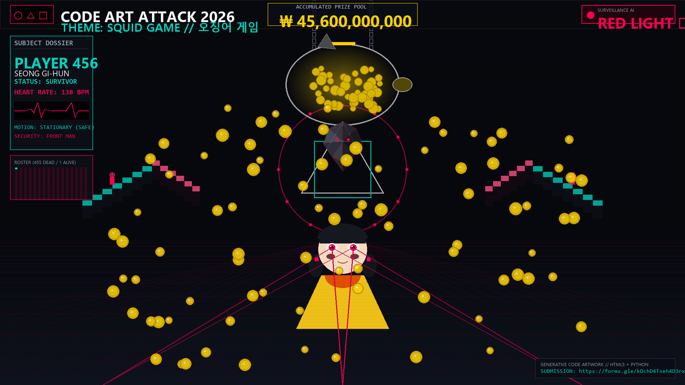

# 🦑 PROJECT 456: ARCHITECTURE OF SURVIVAL
### Official Entry for **CODE ART ATTACK 2026**
**Theme:** *SQUID GAME (오징어 게임)* &bull; **Time:** 8:00 PM – 11:59 PM  
**Submission Form:** [Google Form Link](https://forms.gle/kDchD4Txeh4D3rxD6)



---

## 🎨 Artist Statement & Concept

> *"When society becomes an arena of financial debt, survival is reduced to geometry: Circle, Triangle, Square. The panopticon does not merely watch—it measures our pulse, tracks our motion, and quantifies human existence into 45.6 billion won."*

**PROJECT 456: ARCHITECTURE OF SURVIVAL** is an interactive, multi-layered generative digital artwork created entirely with code. Rather than simply reproducing iconic imagery from *Squid Game*, this piece constructs a dystopian Korean surveillance panopticon that responds dynamically to the observer:

1. **The Young-hee Panopticon & Dynamic Laser Grid (Red Light, Green Light)**  
   The iconic giant animatronic doll is rendered with procedural 2.5D head rotation and parallax gaze tracking. During *Green Light*, she faces away as the soothing yet ominous *"Mugunghwa kkochi pieot seumnida"* melody plays. When *Red Light* triggers, she snaps 180° to face the viewer with crimson robotic optical sensors, projecting sweeping surveillance lasers and locking target crosshairs onto the observer's cursor.

2. **The 45.6 Billion Won Cascade (Physics Particle Engine)**  
   Suspended from dark industrial rafters hangs the giant refractive glass Piggy Bank. Clicking or triggering coin drops releases hundreds of golden Korean Won coins (`₩`) and luminescent caustic dust particles simulated with gravitational acceleration, rotational inertia, floor collisions, and cursor wind deflection.

3. **Sacred Geometry & The Faceted Front Man Mask**  
   The hierarchical symbols (○ Worker, △ Soldier, □ Manager) form an audio-reactive, morphing sacred geometry mandala. Above it hovers a 3D low-poly faceted Front Man mask rendered with directional chiaroscuro polygon shading and real-time 3D vector rotation.

4. **The Escher Impossible Staircase Labyrinth**  
   Flanking the composition are isometric impossible staircases clad in iconic pastel pink (`#ff0055`), mint turquoise (`#00cbb4`), and canary yellow, where silhouetted pink-suited guards march eternally in closed spatial loops.

5. **100% Procedural Synthesized Soundscape (Web Audio API)**  
   Zero external MP3 audio files are used. The sound engine procedurally synthesizes:
   - The eerie celesta/music-box chime melody of the Korean Red Light Green Light chant.
   - An ambient sub-bass drone with detuned oscillators.
   - A biometric heartbeat monitor that dynamically accelerates from 72 BPM to 138 BPM during Red Light.
   - Mechanical servo clicks, elimination alarm sirens, and golden coin chimes.

---

## 🎮 Interactive Controls & Features

| Control | Action |
| :--- | :--- |
| **Mouse Move** | Moves the Doll's optical sensor gaze, rotates the Front Man 3D mask in parallax, and steers the surveillance crosshair. |
| **Mouse Click** | Spawns an explosive burst of golden 45.6B Won coins (`₩`) with pentatonic chimes. |
| **Spacebar / Toggle Light** | Switches between **GREEN LIGHT** (advancing) and **RED LIGHT** (elimination scan & alarm). |
| **Mode 01 - 05** | Switches cameras: *Cinematic Masterwork, Young-hee Panopticon, 45.6B Won Cascade, Sacred Geometry, Escher Labyrinth*. |
| **🔊 AUDIO ON / OFF** | Activates the live synthesized Web Audio soundscape and real-time audio spectrum visualizer. |
| **📺 CRT FX** | Toggles retro CRT scanlines, chromatic aberration, and phosphor monitor curvature. |
| **📸 CAPTURE 4K ARTWORK** | Renders and downloads a pristine 3840×2160 PNG submission screenshot with official contest metadata and verification stamps. |

---

## 🚀 How to Run

### Option 1: Open Directly in Any Browser (Zero Installation)
Simply double-click or drag and drop [`index.html`](index.html) into Google Chrome, Microsoft Edge, Mozilla Firefox, or Safari.

### Option 2: Local HTTP Server (Recommended)
```bash
# Python
python -m http.server 8000
# Open http://localhost:8000 in your browser
```

### Option 3: Regenerate High-Resolution Screenshot via Python
```bash
python generate_art.py
# Generates screenshot.png and artwork.png (1920x1080)
```

---

## 🛠️ Tech Stack & Implementation Details

- **Rendering Engine:** Native HTML5 Canvas 2D + Procedural 3D Vector Math & Matrix Projections
- **Audio Synthesis:** Web Audio API (`OscillatorNode`, `BiquadFilterNode`, `GainNode`, `AnalyserNode`)
- **Particle System:** Real-time 2D/3D physics simulation (gravity, friction, ground bounce, cursor repulsion)
- **Styling:** Vanilla CSS3, Glassmorphism, Retro CRT Scanline Shaders, Responsive Viewport
- **Typography:** Orbitron, Rajdhani, Noto Sans KR, Malgun Gothic
- **Standalone Image Renderer:** Python 3 + Pillow (PIL)

---

## 📋 Contest Submission Checklist

- [x] **Theme:** SQUID GAME (Creative, original artistic interpretation)
- [x] **Artwork created using code:** 100% pure generative code (HTML5 Canvas + Web Audio API + Python)
- [x] **Screenshot ready:** `screenshot.png` (High-resolution 1920x1080)
- [x] **Submission Form:** [https://forms.gle/kDchD4Txeh4D3rxD6](https://forms.gle/kDchD4Txeh4D3rxD6)
- [x] **Deadline:** Before 11:59 PM Tonight

---

**PLAYER 456 &bull; GAME COMPLETED &bull; ALL SURVEILLANCE PROTOCOLS PASSED.**
